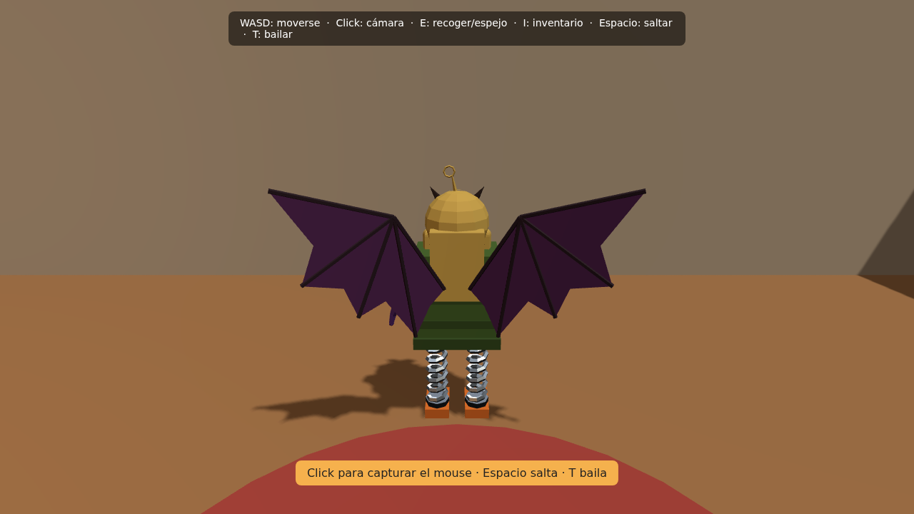
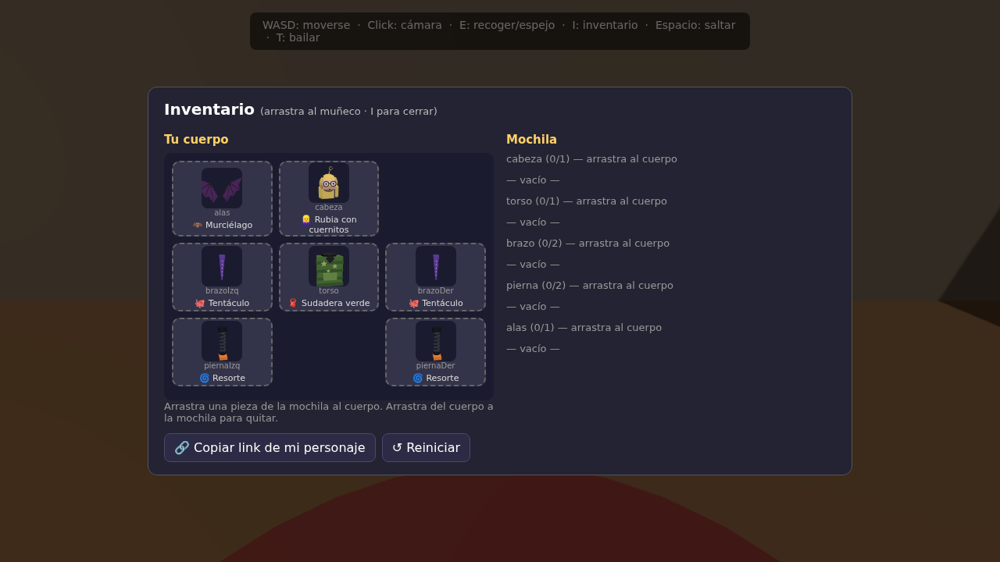

# 🧍 3D Character Creator

Explore a 3D room, pick up body parts from the shelves, equip them with drag & drop and **share your character with a link**. Built with **Three.js + TypeScript + Vite**. Every model is generated procedurally from code: no external 3D assets.

**[▶ Live demo](https://Spdmck-v.github.io/3d-personaje/)** · *(Spanish UI)*

| Explore the room | Dress your character |
|---|---|
|  |  |

## Features

- **Procedural 3D parts**: 5 categories (head, torso, arms, legs, wings), 25+ designs, each built from primitives with low-poly flat shading and shared materials.
- **Third-person gameplay**: WASD movement, jump, dance, pointer-lock camera with wall/shelf anti-clipping, AABB collisions.
- **Inventory system**: backpack with per-type capacity, drag & drop between backpack and body slots, click-to-equip, items drop on the floor when the backpack is full.
- **Live thumbnails**: each piece is rendered once in an offscreen renderer and cached as a data URL.
- **Save & share**: the game auto-saves to `localStorage`; the *Copy link* button encodes your build in the URL (`?b=cabeza:robot,torso:motor,...`). Links are validated against the catalog, so untrusted input can't inject anything.
- **Zero-asset audio**: sound effects synthesized with the Web Audio API.

## Controls

| Key | Action |
|---|---|
| `W A S D` / arrows | Move |
| Mouse (after click) | Rotate camera |
| `E` | Pick up / use mirror / toggle lamp |
| `I` | Open inventory |
| `Space` / `T` | Jump / dance |

## Run it

```bash
npm install
npm run dev        # dev server
npm run build      # typecheck + production build → dist/
npm test           # unit tests (Vitest)
npm run lint       # ESLint
```

## Architecture

```
src/
├── main.ts            # entry point: wires everything together
├── camera.ts          # 3rd-person camera, pointer lock, anti-clipping
├── player.ts          # movement, collisions, jump, dance
├── world.ts           # pickups on shelves / dropped on the floor
├── interactions.ts    # "E" key: pick up, mirror, lamp
├── inventory.ts       # pure inventory logic (unit tested)
├── persistence.ts     # localStorage + URL (de)serialization (unit tested)
├── character.ts       # skeleton of slots + procedural animation
├── room.ts            # room, furniture, lights
├── parts/             # one file per category; add a design = one function + one line
└── ui/                # DOM inventory (drag & drop) and on-screen hints
```

**Design decisions**

- Parts follow a strict contract (anchor at origin, facing `+z`, fixed sizes), so any head fits any torso. Adding a design never touches game logic.
- Materials are shared across all parts; only geometries are disposed when a part is swapped.
- Game logic that doesn't need WebGL (inventory, serialization, catalog integrity) is isolated and covered by tests.

## Tech stack

Three.js · TypeScript (strict) · Vite · Vitest · ESLint · GitHub Actions (CI + deploy to GitHub Pages)

## Roadmap

- [ ] Touch controls (virtual joystick, tap-to-equip)
- [ ] Post-processing (outline on nearby pickups, bloom on neon parts)
- [ ] Physics for dropped pieces (Rapier)
- [ ] Export character as `.glb`

## License

MIT
